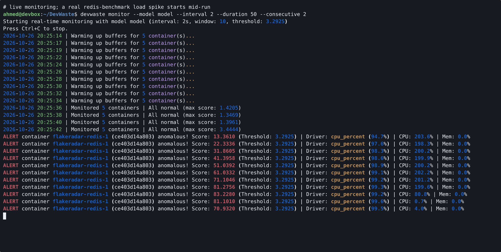
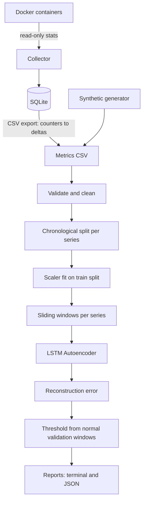

# DevWaste AI

[](https://github.com/Ahmed1-Rebai/DevWaste/actions/workflows/ci.yml)
[](LICENSE)
[](pyproject.toml)

**Deep Learning for Docker Resource Anomaly Detection**

DevWaste AI is a local-first DevOps tool. It collects Docker container resource metrics and detects unusual time-series patterns with a PyTorch LSTM Autoencoder.

It uses no LLMs and no external AI APIs. Training and inference run locally on CPU, and CUDA is optional.

> **Project status:** MVP. The pipeline works end to end and is tested. Detection quality has been measured on synthetic data and on incidents injected into one real container (see [docs/results.md](docs/results.md)). It has not been validated on real production workloads.

## Demo

A real session against the FlakeRadar Docker stack (Postgres, Redpanda, Redis, MLflow, Dagster). The model was trained on 5 minutes of normal metrics, then `devwaste monitor` ran while a `redis-benchmark` load spike hit `flakeradar-redis-1`. Only that container was flagged; the driver was `cpu_percent`.



- Full terminal recording (28 s): [docs/media/devwaste-demo.mp4](docs/media/devwaste-demo.mp4) (asciinema cast: [docs/media/demo.cast](docs/media/demo.cast), driver script: [docs/media/demo.sh](docs/media/demo.sh))
- `scan` and `train` output: [docs/media/screenshot-scan-train.png](docs/media/screenshot-scan-train.png)
- Vertical 28 s clip cut from the same recording: [promo/video/out/devwaste-linkedin-vertical.mp4](promo/video/out/devwaste-linkedin-vertical.mp4) (source in [promo/video/](promo/video/))

## Overview

Development environments can waste resources through unexpected CPU spikes, steadily growing memory, unusual network activity, or containers that stay up longer than needed.

DevWaste AI learns what *normal* resource usage looks like from time-series windows. It flags windows the model cannot reconstruct well. It also gives read-only cleanup suggestions for stopped containers, dangling images, unused networks, and unused volumes.

**Important:** An anomaly does not mean a container is wasting resources. The output is a diagnostic signal, not a conclusion, and DevWaste never acts on it automatically.

## Features

- **Docker monitoring** (`scan`, `collect`): CPU %, memory, network I/O, block I/O, and restart count, computed the same way as `docker stats`. Read-only.
- **Continuous online monitoring** (`monitor`): Streams metrics from running Docker containers, maintains per-container sliding window queues, converts cumulative counters to deltas in real-time, and scores windows against a trained LSTM Autoencoder with per-feature error attribution and persistence filtering.
- **SQLite storage**: timestamped observations in a local database. Exports to CSV with cumulative byte counters converted to per-interval deltas.
- **Synthetic scenarios** (`simulate`): reproducible, labelled `normal`, `cpu-spike`, `memory-growth`, `network-spike`, `oscillating`, and `subtle-oscillation` runs.
- **Leakage-safe preprocessing**: chronological split per series *before* windowing, a scaler fitted on training data only, and windows that never span two containers or runs.
- **LSTM Autoencoder** (`train`): trained on normal windows only. The threshold is the 95th percentile of reconstruction error on normal validation windows.
- **Evaluation** (`evaluate`): precision, recall, F1, FPR, confusion matrix, ROC-AUC, and inference latency. The model is compared on the same windows with calibrated z-score and rolling-statistics baselines and a fixed-threshold rule. Each flagged window is attributed to the feature with the largest reconstruction error. Unlabelled data, such as real collected metrics, gets a detection-only report.
- **Safe cleanup advice** (`cleanup --dry-run`): read-only inspection. The tool suggests commands and never runs them.

## Architecture

See [docs/architecture.md](docs/architecture.md) for component and data-flow diagrams and design decisions.



## Getting Started

### Prerequisites

- Python 3.11 or newer
- Docker Engine, only for `scan`, `collect`, and `cleanup`. Synthetic data, training, and evaluation work without Docker.

### Installation

**Local virtual environment (recommended)**

```bash
git clone https://github.com/Ahmed1-Rebai/DevWaste.git
cd DevWaste
python -m venv .venv
source .venv/bin/activate          # Windows: .venv\Scripts\activate

# Optional: CPU-only PyTorch avoids downloading multi-GB CUDA wheels
pip install torch --index-url https://download.pytorch.org/whl/cpu

pip install -e ".[dev]"
devwaste --help
```

**Docker development container**

```bash
docker compose build
docker compose up -d
docker compose exec devwaste bash
```

The compose file mounts the Docker socket so that `scan` and `collect` work inside the container. Socket access is equivalent to root on the host. Remove that line from `docker-compose.yml` if you only use synthetic data.

### Docker permissions

`scan`, `collect`, and `cleanup` need access to the Docker daemon. Your user must be in the `docker` group (Linux) or be running Docker Desktop. DevWaste only lists and inspects containers, images, networks, and volumes. It never reads environment variables, logs, or container filesystems, and it never starts, stops, or removes anything.

## Usage

### Synthetic workflow (no Docker needed)

```bash
# Normal behaviour for training
devwaste simulate --scenario normal --output data/train.csv --n-samples 3000 --seed 1

# Labelled anomalies for testing. Use a different seed so test noise
# does not repeat training noise.
devwaste simulate --scenario memory-growth --output data/test.csv --n-samples 1000 --seed 2

# Train (artifacts/model.pt + artifacts/metadata.json)
devwaste train --data data/train.csv --output-dir artifacts/

# Evaluate against baselines; optionally save the full JSON report
devwaste evaluate --data data/test.csv --model artifacts/ --output reports/eval.json
```

Scenarios: `normal`, `cpu-spike`, `memory-growth`, `network-spike`, `oscillating`, `subtle-oscillation`. Every row carries `label`, `scenario`, `run_id`, `container_id`, and `container_name`.

Useful `train` options include `--window-size`, `--hidden-dim`, `--num-layers`, `--epochs`, `--threshold-quantile`, `--threshold-method quantile|evt`, `--validation-split`, `--seed`, and `--device cpu|cuda`. Run `devwaste train --help` for the full list.

### Real Docker metrics

```bash
# Containers with a CPU/memory snapshot
devwaste scan
devwaste scan --all --json

# Collect every 5 s for 10 min into data/metrics.db and export a training CSV
devwaste collect --interval 5 --duration 600 --output data/collected.csv

# Train on a period you consider normal, then score later collections.
# Without a 'label' column, evaluate reports flagged windows only.
devwaste train --data data/collected.csv --output-dir artifacts/real
devwaste evaluate --data data/collected_later.csv --model artifacts/real
```

The first collection round of each container is used up by the counter-to-delta conversion. For training, each container needs at least about `window-size / validation-split` rows, which is 50 with the defaults, so the validation slice can hold one window. With `--interval 5`, that is roughly 5 minutes of collection. Scoring needs only `window-size` rows per container.

### Continuous online monitoring

```bash
# Monitor running containers in real time with rich terminal alerts
devwaste monitor --model artifacts/ --interval 5

# Require 2 consecutive anomalous windows to confirm alerts (filters transient jitter)
devwaste monitor --model artifacts/ --consecutive 2

# Stream alerts to JSON Lines and persist raw metrics to SQLite
devwaste monitor --model artifacts/ --db data/metrics.db --output alerts.jsonl --json
```

`--threshold-multiplier` scales the trained threshold, and `--adaptive-rate` (0 to 0.5, off by default) lets the threshold follow slow drift on windows scored as normal. `--duration` stops monitoring after a fixed number of seconds.

### Visual diagnostic reports

```bash
# Generate a self-contained offline HTML visual report from an evaluation JSON report
devwaste report --input reports/eval.json --output reports/report.html

# Or evaluate and generate the HTML report directly
devwaste report --data data/test.csv --model artifacts/ --output reports/report.html
```

### Cleanup recommendations

```bash
devwaste cleanup --dry-run
devwaste cleanup --dry-run --json
```

This lists stopped containers, dangling images, unused networks, and unused volumes, each with a risk level and a suggested command for you to review and run yourself. `--no-dry-run` is refused: DevWaste never deletes anything.

### Full experiment

```bash
python scripts/run_experiment.py --out experiments
```

This trains on synthetic normal data with three seeds, evaluates every scenario against all baselines, and writes `experiments/results.json`. It takes about 20 s on a laptop CPU.

## Results (synthetic data)

> These numbers come from DevWaste's own simulator, not from real workloads. They are copied from [docs/results.md](docs/results.md).

Window-level F1, mean ± std over 3 training seeds × 3 independent test runs. Full table, setup, and caveats are in [docs/results.md](docs/results.md).

| Scenario | LSTM AE | z-score | rolling | fixed threshold |
|---|---|---|---|---|
| cpu-spike | 0.893 ± 0.041 | **0.953 ± 0.017** | 0.677 | 0.998* |
| memory-growth | **0.768 ± 0.078** | 0.678 ± 0.076 | 0.055 | 0.275 |
| network-spike | **0.907 ± 0.041** | 0.782 ± 0.025 | 0.735 | 0.000 |
| oscillating | **0.981 ± 0.013** | 0.735 ± 0.029 | 0.050 | 0.810 |

\* The fixed-threshold rule (`cpu > 80`) overlaps with how `cpu-spike` labels are generated.

The z-score and rolling baselines use the same scaler and the same validation-quantile threshold rule as the LSTM. The LSTM helps most on temporal patterns such as oscillation and gradual growth, while a per-value z-score is better on isolated spikes. False-positive rate on held-out normal runs is about 3.5% for all calibrated detectors.

### Controlled incidents in a real container

`scripts/real_incident_experiment.py` runs an unprivileged, resource-limited container. The container does light normal work, then has CPU burn, memory-leak, disk-burst, and CPU-oscillation incidents injected, with logged ground-truth times. On a fresh run, with window-level metrics and the mean of 3 seeds:

| Detector | F1 | FPR |
|---|---|---|
| LSTM AE | 0.932 | 0.228 |
| z-score | **0.967** | **0.094** |
| fixed threshold | 0.710 | 0.008 |

On these large level-change incidents, the simple z-score is at least as good as the LSTM. Most of the LSTM's false positives occur within 15 s after an incident ends, during recovery. An earlier run exposed a preprocessing flaw (near-constant training features exaggerating tiny shifts), which is now fixed. The details, including the pre-fix run, are in [docs/results.md](docs/results.md#part-2-controlled-incidents-in-a-real-container).

## Safety and Privacy

- No LLMs or external AI inference APIs. All inference is local.
- Collects only resource metrics, names, IDs, and state. It never collects secrets, environment variables, payloads, logs, or filesystem contents.
- Never stops or deletes a container, and never recommends removal because of an anomaly score.
- `cleanup` is read-only. Destructive execution is not implemented and is refused.
- No privileged containers are used to generate workloads; synthetic data is generated in-process.

## Testing

```bash
make lint test         # or run the commands below directly
pytest                 # unit tests: no Docker, no GPU, no network
pytest -m integration  # optional: needs a running Docker daemon
ruff check .
ruff format --check .
```

Tests cover metric parsing, cleaning, leakage prevention (scaler fit and windows per series), deterministic simulation and training, model shapes, artifact round-trips, evaluation metrics, baselines, SQLite storage, CLI commands with a mocked Docker client, and cleanup safety (no mutating Docker calls).

## Project Layout

```
src/devwaste/
  cli.py                 Typer CLI
  config.py              Defaults and feature lists
  collectors/            Docker metrics collector (read-only)
  storage/               SQLite persistence
  data/                  Simulator, cleaning/scaling, dataset split, windows
  models/                LSTM AE, training, scoring, baselines, artifacts, online monitor
  evaluation/            Metrics
  reporting/             Terminal/JSON reports and the offline HTML report
  safety/                Read-only cleanup advisor
scripts/
  run_experiment.py            Synthetic benchmark
  real_incident_experiment.py  Controlled incidents in a real container
tests/
docs/                    Architecture, results, demo media
promo/video/             HyperFrames source of the vertical promo clip
```

## Roadmap

- [x] Python package and CLI
- [x] Docker metrics collection
- [x] SQLite storage
- [x] Reproducible synthetic workloads
- [x] Leakage-safe preprocessing
- [x] Train and serialize the LSTM Autoencoder
- [x] Threshold calibration
- [x] Baseline comparison
- [x] Inference in the CLI
- [x] JSON reports and automated tests
- [x] GitHub Actions
- [x] Reproducible synthetic experiment results
- [x] Controlled incident experiment in a real container
- [ ] Evaluation on real (non-injected) incidents
- [x] Per-feature error attribution in reports
- [x] Continuous monitoring mode (collect and score online)

## Limitations

- The reported metrics come from synthetic data and from injected incidents in one real container. Neither represents production workloads.
- High utilisation is not necessarily waste, and anomalies are not necessarily problems.
- A model trained on one set of containers learns *their* normal behaviour. Scoring very different containers will produce many flags.
- Collection is polling-based. Each stats call takes about 1–2 s (calls run in parallel), so intervals under about 2 s are not reliable.
- The z-score baseline beats the LSTM on isolated spikes, so the LSTM is not universally better. Gradual memory growth is detected late, with recall of about 0.65.
- Diagnostic tool only. It is not an autonomous remediation platform.

## Contributing

See [CONTRIBUTING.md](CONTRIBUTING.md), [CODE_OF_CONDUCT.md](CODE_OF_CONDUCT.md) and [SECURITY.md](SECURITY.md). Changes are listed in [CHANGELOG.md](CHANGELOG.md).

## License

MIT. See [LICENSE](LICENSE).
