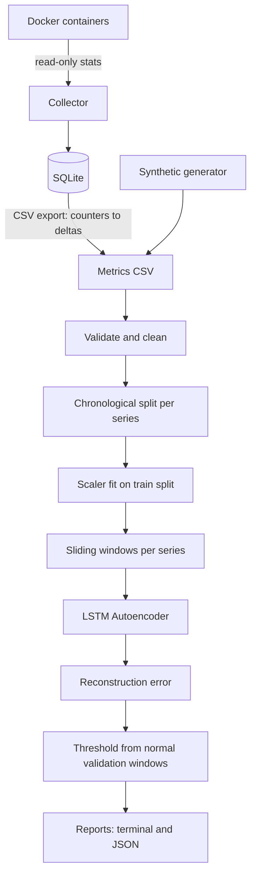

# DevWaste AI

**Deep Learning for Docker Resource Anomaly Detection**

DevWaste AI is a local-first DevOps tool. It collects Docker container resource metrics and detects unusual time-series patterns with a PyTorch LSTM Autoencoder.

It uses no LLMs and no external AI APIs. Training and inference run locally on CPU, and CUDA is optional.

> **Project status:** MVP. The pipeline works end to end and is tested. Detection quality has only been measured on **synthetic data** (see [docs/results.md](docs/results.md)). It has not been validated on real production workloads.

## Overview

Development environments can waste resources through unexpected CPU spikes, steadily growing memory, unusual network activity, or containers that stay up longer than needed.

DevWaste AI learns what *normal* resource usage looks like from time-series windows. It flags windows the model cannot reconstruct well. It also gives read-only cleanup suggestions for stopped containers, dangling images, unused networks, and unused volumes.

**Important:** An anomaly does not mean a container is wasting resources. The output is a diagnostic signal, not a conclusion, and DevWaste never acts on it automatically.

## Features

- **Docker monitoring** (`scan`, `collect`): CPU %, memory, network I/O, block I/O, and restart count, computed the same way as `docker stats`. Read-only.
- **SQLite storage**: timestamped observations in a local database. Exports to CSV with cumulative byte counters converted to per-interval deltas.
- **Synthetic scenarios** (`simulate`): reproducible, labelled `normal`, `cpu-spike`, `memory-growth`, `network-spike`, and `oscillating` runs.
- **Leakage-safe preprocessing**: chronological split per series *before* windowing, a scaler fitted on training data only, and windows that never span two containers or runs.
- **LSTM Autoencoder** (`train`): trained on normal windows only. The threshold is the 95th percentile of reconstruction error on normal validation windows.
- **Evaluation** (`evaluate`): precision, recall, F1, FPR, confusion matrix, ROC-AUC, and inference latency. The model is compared on the same windows with a calibrated z-score baseline, a fixed-threshold baseline, and a rolling-statistics baseline. Unlabelled data, such as real collected metrics, gets a detection-only report.
- **Safe cleanup advice** (`cleanup --dry-run`): read-only inspection. The tool suggests commands and never runs them.

## Architecture

See [docs/architecture.md](docs/architecture.md) for component and data-flow diagrams and design decisions.



## Getting Started

### Prerequisites

- Python 3.11 or newer
- Docker Engine, only for `scan`, `collect`, and `cleanup`. Synthetic data, training, and evaluation work without Docker.

### Installation

**Local virtual environment (recommended)**

```bash
git clone https://github.com/Ahmed1-Rebai/DevWaste.git
cd DevWaste
python -m venv .venv
source .venv/bin/activate          # Windows: .venv\Scripts\activate

# Optional: CPU-only PyTorch avoids downloading multi-GB CUDA wheels
pip install torch --index-url https://download.pytorch.org/whl/cpu

pip install -e ".[dev]"
devwaste --help
```

**Docker development container**

```bash
docker compose build
docker compose up -d
docker compose exec devwaste bash
```

The compose file mounts the Docker socket so that `scan` and `collect` work inside the container. Socket access is equivalent to root on the host. Remove that line from `docker-compose.yml` if you only use synthetic data.

### Docker permissions

`scan`, `collect`, and `cleanup` need access to the Docker daemon. Your user must be in the `docker` group (Linux) or be running Docker Desktop. DevWaste only lists and inspects containers, images, networks, and volumes. It never reads environment variables, logs, or container filesystems, and it never starts, stops, or removes anything.

## Usage

### Synthetic workflow (no Docker needed)

```bash
# Normal behaviour for training
devwaste simulate --scenario normal --output data/train.csv --n-samples 3000 --seed 1

# Labelled anomalies for testing. Use a different seed so test noise
# does not repeat training noise.
devwaste simulate --scenario memory-growth --output data/test.csv --n-samples 1000 --seed 2

# Train (artifacts/model.pt + artifacts/metadata.json)
devwaste train --data data/train.csv --output-dir artifacts/

# Evaluate against baselines; optionally save the full JSON report
devwaste evaluate --data data/test.csv --model artifacts/ --output reports/eval.json
```

Scenarios: `normal`, `cpu-spike`, `memory-growth`, `network-spike`, `oscillating`. Every row carries `label`, `scenario`, `run_id`, `container_id`, and `container_name`.

Useful `train` options include `--window-size`, `--hidden-dim`, `--num-layers`, `--epochs`, `--threshold-quantile`, `--validation-split`, `--seed`, and `--device cpu|cuda`. Run `devwaste train --help` for the full list.

### Real Docker metrics

```bash
# Containers with a CPU/memory snapshot
devwaste scan
devwaste scan --all --json

# Collect every 5 s for 10 min into data/metrics.db and export a training CSV
devwaste collect --interval 5 --duration 600 --output data/collected.csv

# Train on a period you consider normal, then score later collections.
# Without a 'label' column, evaluate reports flagged windows only.
devwaste train --data data/collected.csv --output-dir artifacts/real
devwaste evaluate --data data/collected_later.csv --model artifacts/real
```

The first collection round of each container is used up by the counter-to-delta conversion. For training, each container needs at least about `window-size / validation-split` rows, which is 50 with the defaults, so the validation slice can hold one window. With `--interval 5`, that is roughly 5 minutes of collection. Scoring needs only `window-size` rows per container.

### Cleanup recommendations

```bash
devwaste cleanup --dry-run
devwaste cleanup --dry-run --json
```

This lists stopped containers, dangling images, unused networks, and unused volumes, each with a risk level and a suggested command for you to review and run yourself. `--no-dry-run` is refused: DevWaste never deletes anything.

### Full experiment

```bash
python scripts/run_experiment.py --out experiments
```

This trains on synthetic normal data with three seeds, evaluates every scenario against all baselines, and writes `experiments/results.json`. It takes about 20 s on a laptop CPU.

## Results (synthetic data)

Window-level F1, mean of 3 training seeds. Full table, setup, and caveats are in [docs/results.md](docs/results.md).

| Scenario | LSTM AE | z-score baseline | Fixed threshold |
|---|---|---|---|
| cpu-spike | 0.857 | **0.973** | 0.997* |
| memory-growth | **0.919** | 0.893 | 0.444 |
| network-spike | **0.889** | 0.843 | 0.000 |
| oscillating | **0.976** | 0.736 | 0.805 |

\* The fixed-threshold rule (`cpu > 80`) overlaps with how `cpu-spike` labels are generated.

The LSTM helps most on temporal patterns such as oscillation and gradual growth. A simple per-value z-score is better for isolated spikes. False-positive rate on a held-out normal run is 2.6% (LSTM) vs 3.0% (z-score).

## Safety and Privacy

- No LLMs or external AI inference APIs. All inference is local.
- Collects only resource metrics, names, IDs, and state. It never collects secrets, environment variables, payloads, logs, or filesystem contents.
- Never stops or deletes a container, and never recommends removal because of an anomaly score.
- `cleanup` is read-only. Destructive execution is not implemented and is refused.
- No privileged containers are used to generate workloads; synthetic data is generated in-process.

## Testing

```bash
pytest                 # unit tests: no Docker, no GPU, no network
pytest -m integration  # optional: needs a running Docker daemon
ruff check .
ruff format --check .
```

Tests cover metric parsing, cleaning, leakage prevention (scaler fit and windows per series), deterministic simulation and training, model shapes, artifact round-trips, evaluation metrics, baselines, SQLite storage, CLI commands with a mocked Docker client, and cleanup safety (no mutating Docker calls).

## Project Layout

```
src/devwaste/
  cli.py                 Typer CLI
  config.py              Defaults and feature lists
  collectors/            Docker metrics collector (read-only)
  storage/               SQLite persistence
  data/                  Simulator, cleaning/scaling, dataset split, windows
  models/                LSTM AE, training, scoring, baselines, artifacts
  evaluation/            Metrics
  reporting/             Terminal/JSON report rendering
  safety/                Read-only cleanup advisor
scripts/run_experiment.py
tests/
docs/
```

## Roadmap

- [x] Python package and CLI
- [x] Docker metrics collection
- [x] SQLite storage
- [x] Reproducible synthetic workloads
- [x] Leakage-safe preprocessing
- [x] Train and serialize the LSTM Autoencoder
- [x] Threshold calibration
- [x] Baseline comparison
- [x] Inference in the CLI
- [x] JSON reports and automated tests
- [x] GitHub Actions
- [x] Reproducible synthetic experiment results
- [ ] Evaluation on real labelled container incidents
- [ ] Per-feature error attribution in reports
- [ ] Continuous monitoring mode (collect and score online)

## Limitations

- Synthetic data does not represent production workloads. The reported metrics come from synthetic data only.
- High utilisation is not necessarily waste, and anomalies are not necessarily problems.
- A model trained on one set of containers learns *their* normal behaviour. Scoring very different containers will produce many flags.
- Collection is polling-based. Each stats call takes about 1–2 s (calls run in parallel), so intervals under about 2 s are not reliable.
- The z-score baseline beats the LSTM on isolated spikes. The LSTM is not universally better.
- Diagnostic tool only. It is not an autonomous remediation platform.

## License

MIT (as declared in `pyproject.toml`). Add a `LICENSE` file before distributing.
