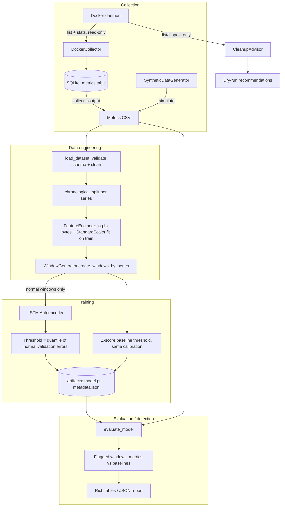
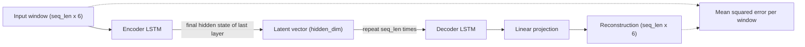
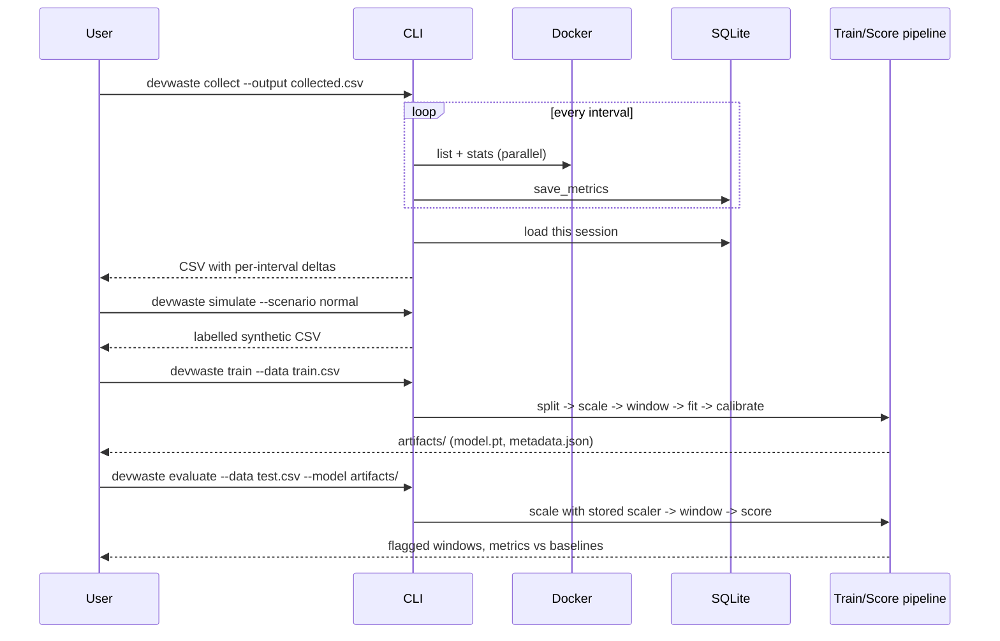

# DevWaste AI - Architecture

## Overview

DevWaste AI is a local-first CLI application. It collects Docker resource metrics, builds leakage-safe time-series windows, and scores them with a PyTorch LSTM Autoencoder. Everything runs in one Python process: there are no services, no web UI, and no external AI APIs.

## System Architecture

## Components

### Collection (`collectors/docker_collector.py`)

- `DockerCollector` wraps the Docker SDK client. You can inject a client for tests.
- One non-streaming `container.stats()` call provides both `cpu_stats` and `precpu_stats`. CPU % uses the `docker stats` formula: `cpu_delta / system_delta * online_cpus * 100`.
- Memory usage excludes page cache (`inactive_file` on cgroup v2), matching `docker stats`.
- Network and block I/O are **cumulative counters**. They are stored raw and converted to per-interval deltas on export (`cumulative_to_deltas`), clipped at 0 when a counter resets after a restart.
- Stats calls block for about 1–2 s each, so they run in a thread pool of up to 8 workers.
- Failures for a single container (for example, one that is restarting) are logged and skipped.

### Storage (`storage/sqlite_store.py`)

- One `metrics` table, indexed on `(container_id, timestamp)`. Batch inserts use `executemany`.
- The default path is `./data/metrics.db`, relative to the working directory, never inside the installed package.

### Synthetic data (`data/simulator.py`)

- Every scenario starts from the same normal process: CPU noise with a slow cycle, bounded random-walk memory, and steady I/O. The anomaly is then injected with an explicit label rule:

| Scenario | Injection | Label = 1 when |
|---|---|---|
| `normal` | none | never |
| `cpu-spike` | bursts of 2–6 samples at ~90% CPU, ~5% coverage | inside a burst |
| `network-spike` | bursts of 2–6 samples with 5–10× rx/tx | inside a burst |
| `memory-growth` | linear leak from 40% of the run, +45 pp by the end | leak adds > 10 pp |
| `oscillating` | ±40% CPU / ±15% memory sine (period 20) from 50% of the run | after onset |

- Each call uses an isolated `numpy.random.Generator(seed)` and fixed start timestamps, so the same seed always gives identical data. The global NumPy RNG is never touched.
- Rows carry `scenario`, `run_id`, `container_id`, and `container_name`.

### Data engineering (`data/features.py`, `data/dataset.py`, `data/windows.py`)

- **Features:** `cpu_percent`, `memory_percent`, and the four byte deltas. Byte features are `log1p`-transformed (heavy-tailed), then standardized.
- **Cleaning:** coerce to numeric, replace ±inf with NaN, forward-fill within each series (past values only), back-fill leading gaps, fill remaining gaps with 0, and clip negatives to 0.
- **Series:** identified by `container_id` and/or `run_id`. Cleaning, splitting, windowing, and the rolling baseline all operate per series.
- **Split:** for each series, the first 80% of observations go to training and the rest to validation, decided on raw rows *before* windowing.
- **Windows:** fixed length, stride 1, built per series so no window mixes containers or runs. A window is labelled anomalous if any sample in it is.

### Model (`models/lstm_autoencoder.py`)

- Repeat-vector design: the decoder sees only the latent vector, so it has to compress the window's shape into `hidden_dim` numbers.
- Defaults: 1 layer, hidden 16, window 10. That is 3,814 parameters, and training takes seconds on CPU.

### Training (`models/train.py`)

1. Load and clean, then split chronologically per series.
2. Fit the scaler on **normal training rows only**.
3. Window both splits per series, then drop any window containing a labelled anomaly. Unlabelled data is assumed normal.
4. Adam with gradient clipping, ReduceLROnPlateau, and early stopping on validation loss. Keep the best epoch.
5. Threshold = `quantile(validation errors, 0.95)`. Calibrate the z-score baseline with the same rule.
6. Save `model.pt` (state dict, loaded with `weights_only=True`) and `metadata.json` (hyperparameters, scaler state, thresholds, and loss history).

All RNGs (Python, NumPy, torch, DataLoader shuffling) are seeded, so repeated CPU runs with the same seed produce identical weights. This is covered by a test.

### Evaluation (`models/score.py`, `evaluation/metrics.py`, `models/baselines.py`)

- The stored scaler is restored and data is windowed per series with the stored window size. Errors are computed in batches.
- **Labelled data:** window-level precision, recall, F1, FPR, TPR, a 2×2 confusion matrix, and ROC-AUC. These are computed for the model and for each baseline on the same windows.
- **Unlabelled data:** number and fraction of flagged windows, plus the highest-scoring windows with container and time range.
- **Baselines:**
  - `zscore`: max |z| per window, calibrated like the model. This is the fair comparison.
  - `threshold`: fixed rules (`cpu > 80`, `mem > 80`).
  - `rolling`: past-only rolling z-score per series.

  The point-level baselines are aggregated to windows by max.

### Reporting (`reporting/reports.py`)

Rich tables for terminal output. JSON output goes through `typer.echo` rather than Rich so it stays machine-parseable, and `--output` writes the full report to disk.

### Safety (`safety/cleanup.py`)

`CleanupAdvisor` only calls `list` methods. For each finding it reports the item count, example names, approximate size, risk level, a caution, and a suggested command for a human to run. The CLI refuses `--no-dry-run`. A test asserts that no `remove`, `stop`, `kill`, or `prune` method is ever called.

## Data Flow

## Key Design Decisions

| Decision | Rationale |
|---|---|
| Split before windowing, per series | Overlapping windows would otherwise leak validation samples into training. |
| Scaler fit on normal training rows only | No statistics from validation or test data, or from anomalies, reach preprocessing. |
| Train only on normal windows | An autoencoder trained on anomalies learns to reconstruct them, which lowers their scores. |
| Threshold from validation quantile | Data-driven, and never sees test data. 0.95 implies about a 5% expected false-positive rate on normal data. |
| Byte counters to deltas, log1p | Cumulative counters are non-stationary. Byte rates span orders of magnitude. |
| Calibrated z-score baseline | Same scaler and same calibration rule, so any LSTM advantage comes from temporal modelling. |
| Small model (hidden 16, 1 layer) | Trains in seconds on a laptop CPU, which suits a diagnostic tool. |
| Read-only Docker access | Diagnostic only. Destructive actions remain a human decision. |

## Limitations

1. Results so far are on synthetic data only (see [results.md](results.md)).
2. Per-window MSE does not say *which* metric caused a flag.
3. A model is specific to the containers and period it was trained on, and there is no drift handling.
4. Polling collection at 1–2 s resolution misses sub-second bursts.
5. Window labels with stride 1 are highly correlated, so metrics count windows, not incidents.
